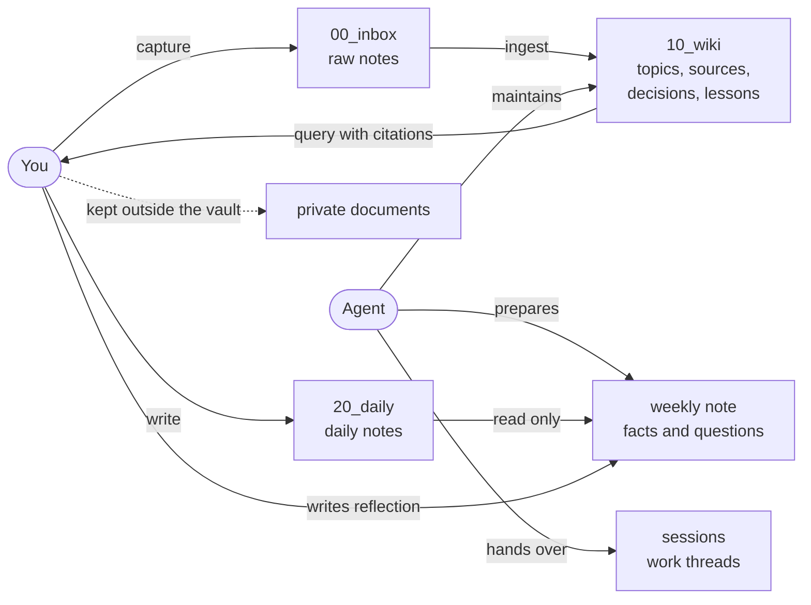

# How it works

The vault is a folder of Markdown files with one rules file, `AGENTS.md`, that an AI agent reads at the start of every session. You and the agent write in different places, and a few routines keep the wiki tidy without you having to remember them.

## Three ideas behind it

The first is Andrej Karpathy's [LLM wiki](https://gist.github.com/karpathy/442a6bf555914893e9891c11519de94f): raw sources that the model only reads, a wiki that the model writes, and a schema file with the rules. Its operations are ingest (work a source into the wiki), query (answer from the wiki with citations) and lint (find broken links, orphans and contradictions), with a catalogue `index.md` and an append-only `log.md`.

The second is the method of loci, the memory palace: a stable floor plan with few, clearly separated rooms and one fixed entry point. That is why the folder layout is small and does not change often, and why every page is reachable from the index.

The third is the idea of an agent harness: the rules file, the skills (repeatable routines written as Markdown instructions), the hooks and scripts that check things automatically, and a review step in which a person checks what the agent drafted.

## Layers and who writes where



You own the inbox, your daily notes, the reflection in each weekly note, and your private documents, which stay outside the vault. The agent owns the wiki, the work threads and its memory. It reads your layers, but it never edits them; the only exception is a status line on an inbox note once it is filed.

## The routines

| Routine | Skill or script | What happens |
|---|---|---|
| Capture | `ingest` | You paste text or a link, or drop a file into `00_inbox/`. |
| Ingest | `ingest` | The agent turns inbox notes into wiki pages, links them, updates the index and the log, and moves the note to `00_inbox/ingested/`. |
| Query | `query` | You ask a question; the agent answers from the wiki and cites every page, and says when the vault does not know. |
| Weekly review | `weekly-review` | The agent collects the facts of the week, recurring threads from your daily notes, open tasks and three to five questions. You write the reflection. |
| Lint | `wiki_lint.py` | Broken links, pages missing from the index, orphans, wrong review values. |
| Session start | `session_start.py` | Prints what waits for you, what waits for the agent, the inbox, open threads and the last log entries. |
| Self-evaluation | `harness-review` | Every 14 days: what caused friction, which rules to sharpen or delete. At most three changes. |

Two more skills help with quality: `self-check` questions a result before you see it, and `writing-style` removes the typical tells of machine-written text. `requirements` writes down what a new routine must do before the agent builds it.

## The review loop

The agent marks every draft you should check with `review: needed` in the frontmatter. You comment directly in the text with a callout:

```markdown
> [!feedback] This contradicts what I wrote last month, check the source.
```

and set `review: feedback`. When you say "process feedback", the agent changes the text, turns each callout into `> [!done] what changed`, and sets the status back. Nothing has to be explained twice in a chat, and the history stays in the note.

## Work threads and handover

A chat session forgets everything when it ends. A work thread in `sessions/` is the memory of one piece of work: goal, next step, what to read first, what is settled, open questions and a log. At the end of a session the agent updates the thread. The next session starts with `continue sessions/<thread>.md` and goes on without asking.

Each log line ends with a friction note: what cost time and what would have prevented it. The harness review reads these lines, and a friction that repeats becomes a rule, a check or a better skill. Every mistake should change the setup, not only the result.

## Keeping the context small

What is loaded into every session costs attention and money. `AGENTS.md` and the memory index therefore hold rules only. Reference material sits in skills and READMEs and is read when needed. Logs and long files are searched with `grep` and never read whole.
